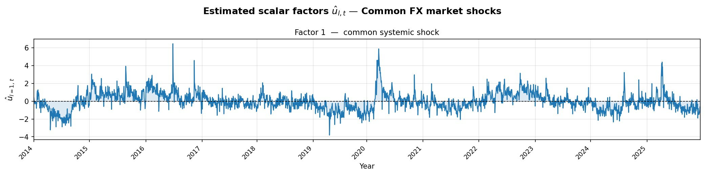
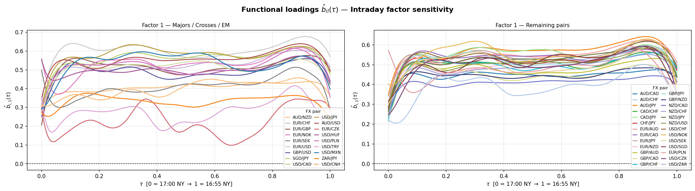
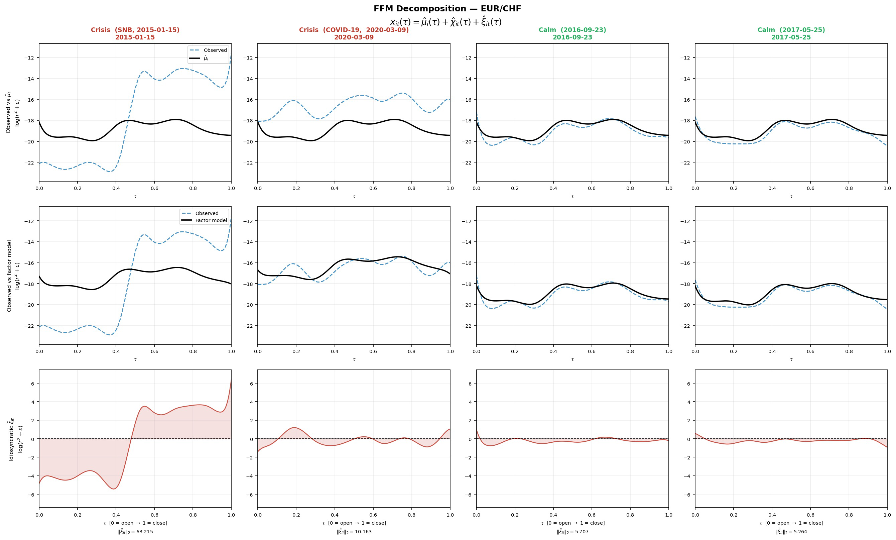
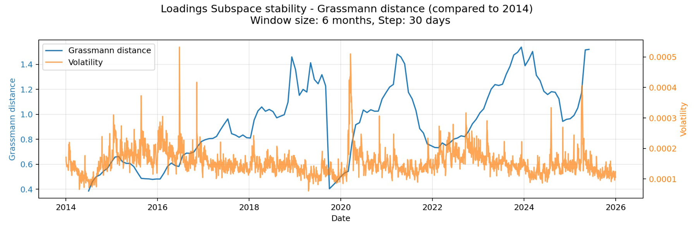
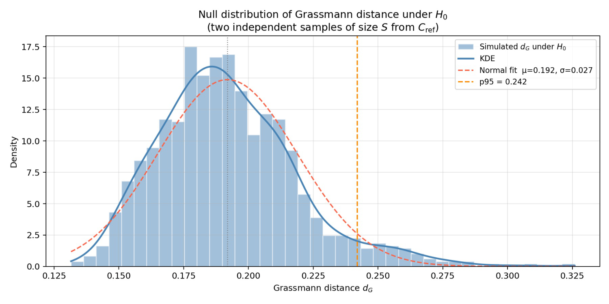
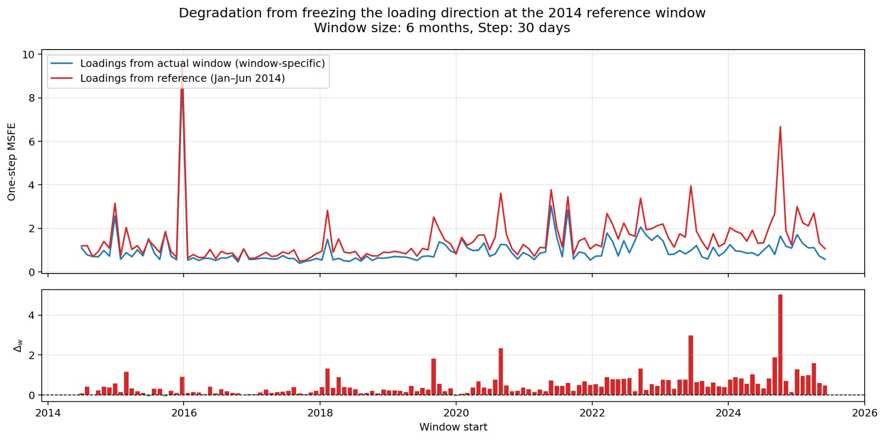
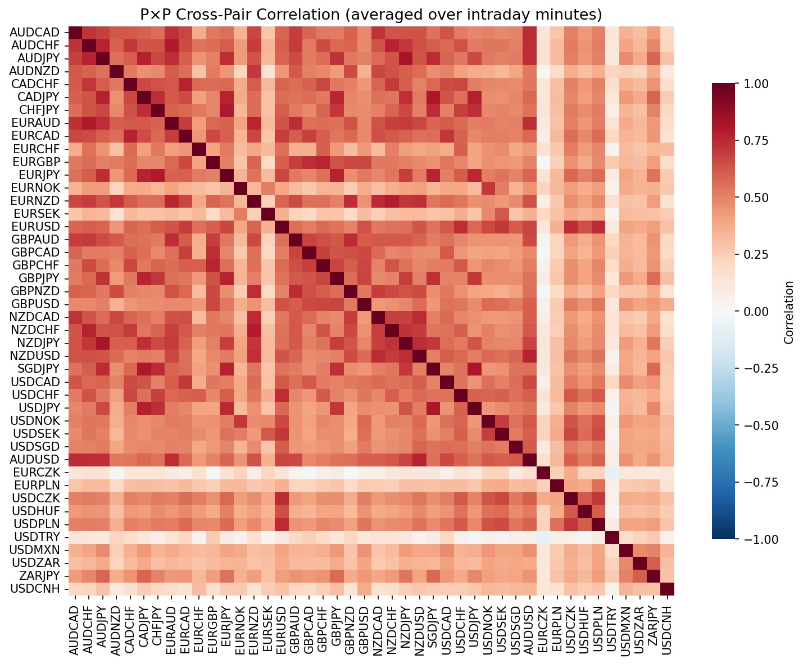

# Functional Factor Models for Intraday FX Volatility

**Is the loading structure of FX volatility stable over time?**
A functional factor model fitted to the intraday volatility curves of **44 currency pairs (2014–2025)**,
a geometric study of how its loading subspace moves, and what that movement costs for forecasting.

*MSc thesis — EPFL, 2026 · Dorah Borgi · supervised by Prof. Victor Panaretos and Prof. Shahin Tavakoli*

[Final presentation (PDF)](docs/final_presentation.pdf)

 

---

## TL;DR

- **Data → curves.** 5-minute FX returns from HistData/Dukascopy are turned into one smooth
  log-volatility curve per pair and trading day (288 points, 17:00 → 16:55 New York), giving a
  panel of N = 44 pairs × T = 3,062 days.
- **One market-wide volatility factor.** The Functional Factor Model of Hallin, Nisol & Tavakoli (2023)
  selects r̂ = 1. That factor explains **28.8%** of the variance of a daily curve on average, and up to **81.6%**
  on stress days (Brexit). G10 pairs load strongly, emerging-market pairs weakly.
- **The loading subspace is *not* stable.** Grassmann distances between rolling 6-month loading subspaces
  range over [0.40, 1.53], against a simulated null of [0.12, 0.33]. The instability is **gradual and
  multi-regime**, not a single datable break. Level shocks such as COVID rescale the operator without
  rotating it, while structural drift (2017+, 2019, 2023–24) rotates it.
- **Rotation costs forecast accuracy.** Freezing the 2014 loadings degrades one-step forecasts, and the
  degradation grows with the Grassmann distance (ρ ≈ 0.26). Among the forecasting models compared,
  a functional HAR on the idiosyncratic part does best: **−20% MAFE and −41% MSFE** against a random-walk benchmark.

<p align="center">
  <br>
  <em>Estimated factor score û<sub>1t</sub>: a market-wide intraday volatility index, with spikes at Brexit, COVID, 2022 and the 2025 tariff turmoil.</em>
</p>

---

## Method

Each trading day *t* and pair *i* gives a curve $x_{it}(\tau)$, $\tau \in [0,1]$, of log-volatility
$\log(r^2 + \varepsilon_i)$, smoothed with penalised cubic B-splines. The FFM writes

$$
x_{it}(\tau) = \mu_i(\tau) + \sum_{k=1}^{r} b_{ik}(\tau)\, u_{kt} + \xi_{it}(\tau),
$$

with scalar factor scores $u_{kt}$ (common daily shocks), functional loadings $b_{ik}(\tau)$
(the intraday sensitivity of pair *i*) and idiosyncratic curves $\xi_{it}(\tau)$.

| Step | What is done | Where |
|---|---|---|
| **Data** | 1-min bars → 5-min grid (gaps ≤ 15 min interpolated) → log-returns → (day × 288) matrices | [`data_processing.py`](src/data_processing.py) |
| **Proxy & smoothing** | $\log(r^2+\varepsilon_i)$ (removes the right skew of $\lvert r\rvert$), P-splines with GCV-selected $\lambda_i$ | [`ffm_transform.py`](src/ffm_transform.py), [`ffm_smoothing.py`](src/ffm_smoothing.py) |
| **Estimation** | Gram matrix of the centred panel → leading eigenpairs → scores $\hat u$, loadings $\hat b$, common $\hat\chi$, idiosyncratic $\hat\xi$ | [`ffm_fx_real.py`](src/ffm_fx_real.py), [`factor_model_fcts.py`](src/factor_model_fcts.py) |
| **Number of factors** | Functional Bai–Ng IC, eigenvalue / growth ratios (Ahn & Horenstein), ABC (Alessi, Barigozzi & Capasso) | [`ffm_fx_real.py`](src/ffm_fx_real.py), [`abc_method.py`](src/abc_method.py) |
| **Stability** | Rolling windows → Grassmann distance $d_G = \arccos\lvert\langle V, V'\rangle\rvert$ between loading subspaces; simulated null; CUSUM, Bai–Perron, Hamed–Rao | [`ffm_stability.py`](src/ffm_stability.py), [`dg_simulation.py`](src/dg_simulation.py) |
| **Break tests** | Dette & Kutta (2021) change-point tests on the eigenvalues / eigenfunctions of the covariance operator | [`dette_kutta.py`](src/dette_kutta.py) |
| **Forecasting** | Score: RW / AR / ARIMA / ARFIMA / HAR / GARCH. Idiosyncratic: functional Ljung–Box test, then RW / FAR (FPCA + VAR) / functional HAR. Recombination on the original scale, MSFE / MAFE | [`ffm_forecasting.py`](src/ffm_forecasting.py) |

Loadings are identified only up to rotation, so stability is studied on the **subspace**
they span (the Grassmann manifold), not on individual loading curves. A test on the mean loading would
miss a pure rotation.

---

## Results

<table>
<tr>
<td width="50%"><br>
<em>Functional loadings b̂<sub>i1</sub>(τ): positive for every pair at every τ, with bumps at the session opens. EM pairs (EUR/CZK, USD/TRY, ZAR/JPY) load weakly.</em></td>
<td width="50%"><br>
<em>EUR/CHF decomposition: COVID is systemic (the common part lifts the curve); the 2015 SNB floor removal is idiosyncratic (a huge residual).</em></td>
</tr>
<tr>
<td><br>
<em>Grassmann distance to the Jan–Jun 2014 subspace (blue) vs. mean volatility (orange). The subspace drifts steadily, and COVID is a level shock, not a rotation.</em></td>
<td><br>
<em>Null distribution of d<sub>G</sub> when every window shares the 2014 eigenspace: [0.12, 0.33]. Observed distances: [0.40, 1.53].</em></td>
</tr>
<tr>
<td><br>
<em>One-step MSFE with each window's own loadings vs. frozen 2014 loadings. The cost of freezing grows with the rotation.</em></td>
<td><br>
<em>Cross-pair correlation of the volatility curves: a tightly linked G10 block, a looser EM cluster, and USD/TRY isolated.</em></td>
</tr>
</table>

| Quantity | Value |
|---|---|
| Panel | N = 44 pairs, T = 3,062 days, M = 288 intraday points |
| Selected number of factors | r̂ = 1 (ER & GR agree; IC over-penalises when N ≪ T; ABC unstable across permutations) |
| Variance explained by the common component | 28.8% on average, 81.6% on the Brexit day |
| Grassmann distance to the 2014 baseline | 0.40 – 1.53 (mean ≈ 0.93) vs. a null of 0.12 – 0.33 |
| Bai–Perron on the distance series | 7 breaks (BIC), so 8 regimes; CUSUM does not reject (the moves cancel out) |
| Dette–Kutta (Δ = 0) | no significant break; the eigenvalue and eigenfunction break dates do not coincide |
| Best forecast (vs. RW × RW) | HAR on the idiosyncratic part: −20% MAFE, −41% MSFE; the score is close to a random walk (AR ≈ RW) |
| Frozen vs. updated loadings | the degradation Δ<sub>w</sub> is positively correlated with d<sub>G</sub> (ρ ≈ 0.26) |

The whole pipeline was re-run on the **unsmoothed** proxy (notebook `04`) and gives the same factor and subspace.

**Limitations.** All pairs are weighted equally. The cross-section is not independent (shared legs,
triangular arbitrage). The forecast comparison is on a single date (2026-01-02), so it is
illustrative, not a full backtest. Break tests have little power against a slow, monotone rotation.

---

## Repository structure

```
fx-functional-factor-model/
├── src/                          # library code (imported by the notebooks)
│   ├── data_processing.py        # raw data loading, 5-min grid, log-returns, trading-day matrices
│   ├── ffm_transform.py          # log(r² + ε) volatility proxy
│   ├── ffm_smoothing.py          # penalised B-spline smoothing, GCV
│   ├── ffm_fx_real.py            # FFM estimation pipeline (run_ffm) + core plots
│   ├── factor_model_fcts.py      # panel construction, Gram matrix, rolling-window FFM
│   ├── abc_method.py             # ABC selection of the number of factors
│   ├── ffm_stability.py          # Grassmann distances, CUSUM, Bai–Perron, Hamed–Rao, rolling diagnostics
│   ├── dg_simulation.py          # simulated / bootstrap null distribution of the Grassmann distance
│   ├── dette_kutta.py            # Dette & Kutta (2021) eigensystem break tests
│   ├── ffm_forecasting.py        # factor & idiosyncratic forecasting, reconstruction, evaluation
│   ├── ffm_eda.py, ffm_eda_focused.py, functions.py   # exploratory analysis & plotting helpers
│   └── paths.py                  # repository paths (data/, figures/)
├── scripts/
│   ├── download_histdata.py      # HistData 1-min bars
│   ├── download_dukascopy.py     # Dukascopy ticks → 5-min bars (async)
│   └── build_dataset.py          # raw data → (trading day × 5-min) matrices
├── notebooks/
│   ├── 01_data_eda_ffm_rolling.ipynb   # data, EDA, FFM fit, number of factors, rolling r̂
│   ├── 02_forecasting.ipynb            # factor & idiosyncratic forecasts, model comparison
│   ├── 03_stability.ipynb              # Grassmann geometry, null simulation, break tests
│   └── 04_raw_ffm.ipynb                # robustness: pipeline on the unsmoothed proxy
├── data/README.md                # data sources and how to rebuild the dataset
├── docs/                         # final presentation + README figures
└── figures/                      # generated figures (git-ignored)
```

---

## Getting started

```bash
git clone https://github.com/dorahborgi/fx-functional-factor-model.git
cd fx-functional-factor-model
python -m venv .venv && source .venv/bin/activate      # Python 3.11
pip install -r requirements.txt
```

**1. Build the dataset.** See [`data/README.md`](data/README.md) for details.

```bash
python scripts/download_histdata.py --start-year 2014
python scripts/download_dukascopy.py --pairs USDCNH --start 2014-01-01 --end 2026-01-31
python scripts/build_dataset.py
```

**2. Run the notebooks in order** from the `notebooks/` folder:

1. `01_data_eda_ffm_rolling.ipynb` fits the model and caches the shared objects in `data/shared/`.
2. `03_stability.ipynb` computes the Grassmann distances in `data/results/`.
3. `02_forecasting.ipynb` runs the forecasts. Its last section uses the distances from `03`.
4. `04_raw_ffm.ipynb` runs the robustness check on the raw proxy.

Figures are written to `figures/`. Rolling-window and simulation cells take several minutes each.

**Minimal example**

```python
import sys; sys.path.insert(0, "src")
import pandas as pd
from data_processing import FX_PAIRS
from ffm_smoothing import smoothing_for_ffm
from ffm_fx_real import run_ffm

vol = {p: pd.read_parquet(f"data/{p}_matrix_lg.parquet").loc["2014-01-01":] for p in FX_PAIRS}
vol = {p: m[pd.to_datetime(m.index).dayofweek < 5] for p, m in vol.items()}   # drop weekends

curves = smoothing_for_ffm(vol, smooth=True, n_basis=20, drop_sparse=True, max_nan_pct=0.70)
ffm    = run_ffm(curves, k_max=5, min_coverage=0.7, silent=True)
# ffm["r_hat"] == 1, ffm["X"].shape == (44, 3062, 288); also U_hat, B_hat, Chi_hat, Xi_hat, mu, days, pairs, ...
```

---

## References

- Hallin, M., Nisol, G. & Tavakoli, S. (2023). Factor models for high-dimensional functional time series I & II. *Journal of Time Series Analysis*.
- Ahn, S. C. & Horenstein, A. R. (2013). Eigenvalue ratio test for the number of factors. *Econometrica*.
- Alessi, L., Barigozzi, M. & Capasso, M. (2010). Improved penalization for determining the number of factors in approximate factor models. *Statistics & Probability Letters*.
- Bai, J. & Ng, S. (2002). Determining the number of factors in approximate factor models. *Econometrica*.
- Bai, J. & Perron, P. (1998). Estimating and testing linear models with multiple structural changes. *Econometrica*.
- Dette, H. & Kutta, T. (2021). Detecting structural breaks in eigensystems of functional time series. *Electronic Journal of Statistics*.
- Hamed, K. H. & Rao, A. R. (1998). A modified Mann–Kendall trend test for autocorrelated data. *Journal of Hydrology*.
- Corsi, F. (2009). A simple approximate long-memory model of realized volatility. *Journal of Financial Econometrics*.
- Andersen, T. G. & Bollerslev, T. (1997). Intraday periodicity and volatility persistence in financial markets. *Journal of Empirical Finance*.

## License

Code released under the [MIT License](LICENSE). Market data are not redistributed; see [`data/README.md`](data/README.md).
